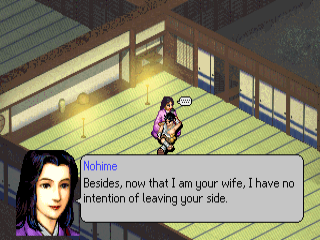
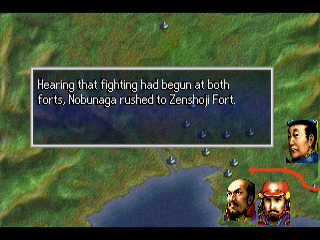
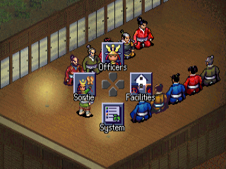
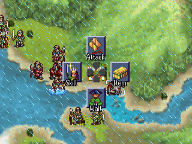
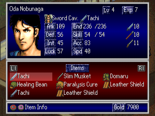
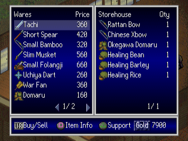

# Oda Nobunaga Den — English Translation

A fan translation of **Oda Nobunaga Den** (織田信長伝, "The Legend of Oda Nobunaga", Koei,
1998) for the PlayStation into English. Unlike Koei's *Nobunaga's Ambition* strategy games,
this is a story-driven tactics game: you follow Nobunaga's life chapter by chapter, from his
first battle as the "Fool of Owari" through Okehazama, the march on Kyoto and the wars against
the Takeda, the Azai and Asakura and the Ikko-ikki. Between the hex-map battles you hold
council with your retainers, equip your officers, and visit the merchant, the blacksmith and
the storehouse. The game was only released in Japan.

> **This is a full machine translation.** All of the game's text was translated from
> Japanese by an AI model, not by a human translator, and it has not been
> proofread by a fluent Japanese speaker. Expect occasional mistranslations, awkward
> phrasing and inconsistent terms. Corrections are welcome.

> **This is a beta (v0.9.3).** All of the game's text is in English and the main story has
> been played through to the Honnoji ending, but most of the "what if" branch chapters after
> Honnoji were only checked as text, not in play. Expect some text that is squeezed, cut
> short or wrapped oddly.

This repository contains the English text and the tools that build the patch.
It does **not** contain the game, any of its data, or the Japanese script — you need
your own copy of the game.

## Screenshots

| | | |
|:-:|:-:|:-:|
|  |  |  |
| Event dialogue | Battle introduction | Council with the retainers |
|  |  |  |
| Battle | Officer status | Merchant |

## What's translated

- All event scripts: every chapter's dialogue, narration, place captions, chapter titles,
  battle victory and defeat conditions and the choices
- Officer, retainer and speaker names (romanised), item, unit type, trait and skill names
- All item descriptions
- Menus, labels, battle messages, battle introductions, the merchant, blacksmith and
  storehouse screens, the settings menu and the memory card messages
- Graphics: the labels of the status, list and shop screens and the floating battle labels
  (stat changes, status effects), redrawn at build time with an original English font
- A proportional English font (original drawings) with word wrap and paging

Long names and labels are shortened where the game's boxes are too small.

## Applying the patch (players)

1. Download the release zip (`Oda_Nobunaga_Den_English_v<version>.zip`) from the Releases
   page. It contains the patch `oda_nobunaga_den_en_v<version>.xdelta`, a `.cue` file and
   a README.txt.
2. You need an unmodified image of the original Japanese disc (serial `SLPS-01595`; the
   later Koei the Best and Teiban reissues are different discs) in the usual two-track
   BIN/CUE form. Only track 1 is patched:

   | Track 1 | |
   |---|---|
   | Size  | 83,874,672 bytes |
   | CRC32 | `BEA2E511` |
   | MD5   | `d69d83c7d78ac754a24514ebe6207dbe` |
   | SHA-1 | `4328af8bc1689e12094e27556da3826eb00cc529` |

   Track 2 (CD audio, 37,810,752 bytes, CRC32 `40E86050`) is used unchanged.
3. Apply the patch to track 1 with an xdelta tool, e.g.
   [Delta Patcher](https://github.com/marco-calautti/DeltaPatcher) or the command line:

   ```
   xdelta3 -d -s "Oda Nobunaga Den (Japan) (Track 1).bin" oda_nobunaga_den_en_v<version>.xdelta "Oda Nobunaga Den (English v<version>) (Track 1).bin"
   ```

4. Put the zip's `Oda Nobunaga Den (English v<version>).cue` next to the patched track 1
   and the original track 2, and open the `.cue` in your emulator.

The patched disc has the same serial, so it uses the same memory card saves as the
Japanese game.

## Building from source

Requirements: Python 3.10+, `xdelta3` (for the patch file).

```
python -m venv .venv
.venv/bin/pip install -r requirements.txt
cp "/path/to/Oda Nobunaga Den (Japan) (Track 1).bin" oda_nobunaga_den_track1.bin
cp "/path/to/Oda Nobunaga Den (Japan) (Track 2).bin" oda_nobunaga_den_track2.bin
.venv/bin/python tools/setup.py      # checks the disc, extracts script/ from it
.venv/bin/python tools/build.py      # writes build/oda_nobunaga_den_en_track1.bin (+ track 2, .cue) and the .xdelta
```

`tools/setup.py` checks the disc's SHA-1 and generates `script/`, which holds the
Japanese text from your disc for the translation tools. `script/` and `build/` are
never committed.

To make a release package, run `.venv/bin/python tools/package.py 0.9.3` after building:
it writes `release/Oda_Nobunaga_Den_English_v0.9.3.zip` with the versioned xdelta patch,
the `.cue` and a plain-text README.txt. No disc data is ever packaged.

## Repository layout

| Path | Contents |
|---|---|
| `tl/eex/` | English for the event scripts `DATA/NB*.EEX`, one file per script, by string number (`@N`, `@N.K` = speech K of a dialogue) |
| `tl/names/` | Officer and speaker names |
| `tl/data.txt`, `tl/imsg/` | Item, unit type, trait and skill names (`DATA/DATA.E4`); item descriptions (`DATA/IMSG.E4`) |
| `tl/progstr/` | English for strings in the game program, by address |
| `tl/gfx.txt`, `tl/hexeff.txt` | Text drawn into graphics (screen labels; floating battle labels) |
| `tools/setup.py`, `tools/build.py` | Create `script/`; build the patched disc and the patch |
| `tools/tl.py`, `tools/text.py` | Validates translations, line wrapping and page layout (`apply`, `show`, `check`, `stats`) |
| `tools/iso.py`, `eex.py` | Disc image (ISO 9660, EDC/ECC, the game's own file table), event script format |
| `tools/names.py`, `datae4.py`, `imsg.py` | Names, game data records, item descriptions |
| `tools/progstr.py`, `fmtlimit.py` | Program strings; format-string buffer limits |
| `tools/vwf.py`, `pixfont.py`, `asm.py` | Proportional font (original drawings), word wrap and layout patches; small MIPS assembler |
| `tools/gfx.py`, `hexeff.py`, `tinyfont.py` | Redrawn label graphics (screen labels, battle labels) |
| `tools/package.py` | Makes the release zip (patch + .cue + README.txt with checksums) |
| `tools/dev/`, `tools/emu/` | Development helpers (disassembly, DuckStation automation) |
| `docs/screenshots/` | README screenshots |

## Known issues

- The title logo, the movies, and 完 and the series logo after the credits are unchanged.
- The game stores its Japanese title (織田信長伝) at the start of every save, so the
  memory card screens show it before the English chapter name.
- Most branch chapters after Honnoji and the other endings have not been seen in play, and
  neither has the sortie selection screen. Their text may overflow in places.
- Some labels are squeezed to fit narrow boxes, and some are abbreviated.

Tested in DuckStation only. Bug reports with a screenshot and where it happened are welcome.

## Credits

- Translation and hacking: [damon-daemon](https://github.com/damon-daemon)
- Oda Nobunaga Den © Koei Tecmo. This is an unofficial fan project, not affiliated with
  or endorsed by Koei Tecmo. Please support the official releases.

## License

The tools, fonts, documentation and English translation text in this repository
are released under the [MIT License](LICENSE). This covers only original work in
this repository: the game itself and all of its content (code, Japanese text,
graphics, audio) are copyright Koei Tecmo and are not included or licensed here.
